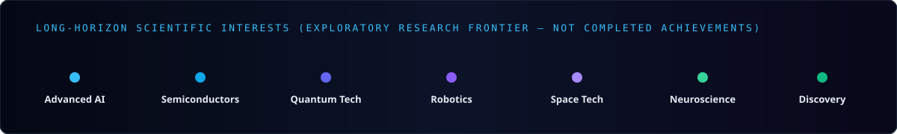

<!-- A. CINEMATIC HERO SECTION -->

  

  
  
  
  

  
    B.Sc. Mathematics Student at <b>The Maharaja Sayajirao University of Baroda (MSU Vadodara)</b> • Building verifiable, multilingual AI, cybersecurity, scientific computing, and open-world simulation systems from first principles.
  

---

## 🧭 Research Command Center

Independent scientific exploration organized across seven core engineering domains:

<table>
  <tr>
    <td width="33%" valign="top">
      <h4>🧠 Artificial Intelligence &amp; ML</h4>
      
Provider-independent LLM routers, multilingual reasoning pipelines (Gujarati, Hindi, English), and evidence-verified AI architectures.

    </td>
    <td width="33%" valign="top">
      <h4>🔬 Scientific Computing &amp; Research</h4>
      
Symbolic mathematics (SymPy), RK45 physics ODE simulations (SciPy), OLS/Monte Carlo statistics, and SHA-256 deterministic reruns.

    </td>
    <td width="33%" valign="top">
      <h4>⚡ Semiconductor Intelligence</h4>
      
Exploratory technical study of chip architecture, EDA workflows, photolithography physics, and hardware-software co-design.

    </td>
  </tr>
  <tr>
    <td width="33%" valign="top">
      <h4>⚛️ Quantum Computing</h4>
      
Long-horizon study of quantum algorithms, post-quantum cryptography (PQC), and mathematical foundations of quantum systems.

    </td>
    <td width="33%" valign="top">
      <h4>🤖 Robotics &amp; Automation</h4>
      
Autonomous task orchestration, deterministic behavior trees, state machines, and intelligent agent coordination.

    </td>
    <td width="33%" valign="top">
      <h4>🏛️ Civic &amp; Educational AI</h4>
      
Inclusive citizen legal-information navigation (<i>Nyaymitra</i>) and strict textbook-grounded Gujarati student learning tools (<i>GRANTH-AI</i>).

    </td>
  </tr>
</table>

---

## 🌌 Project Universe

Every repository listed below reflects **actual implemented code, verified test suites, and real deployment status** — planned capabilities are never presented as completed features.

| Project | Purpose &amp; Architecture | Verified Status | Core Tech | Links |
| :--- | :--- | :--- | :--- | :--- |
| **🔬 ANVESHAN** | Open-source Scientific Research &amp; Discovery Platform featuring SymPy math, 5 SciPy RK45 physics models, CSV workbench, SHA-256 deterministic reruns &amp; OpenAlex/arXiv/PubChem clients. | ✅ **Live on Render** (`v1.2.0` · 30/30 tests passing) | `Python` `FastAPI` `NumPy` `SciPy` `SymPy` `Pandas` `SQLite` | [Repository](https://github.com/dhundhwana-arch/ANVESHAN) · [Live App](https://anveshan-research-lab.onrender.com) |
| **🛡️ VAJRAKAVACH 2070** | Defensive, lawful modular Cybersecurity Observatory with 25 backend modules and dual-engine Neon PostgreSQL + SQLite persistence. | ✅ **Live on Render** (`v1.2.0` · 22 tests passing) | `Python` `FastAPI` `PostgreSQL` `SQLite` `HTML/JS` | [Repository](https://github.com/dhundhwana-arch/vajrakavach-2070) · [Live App](https://vajrakavach-2070.onrender.com/) |
| **⚖️ Nyaymitra 2.0** *(NYAYMITRA-AI)* | Inclusive multilingual legal-information &amp; citizen-navigation system (not legal advice) with FastAPI backend, SQLite+FTS5, and Vanilla JS SPA. | ✅ **Backend &amp; SPA Tested** (475 tests passing · Not yet deployed live) | `FastAPI` `SQLite+FTS5` `JavaScript` `Capacitor` | [Repository](https://github.com/dhundhwana-arch/Nyaymitra-2.0) |
| **🌍 LIFEVERSE 2070** *(EVERYVERSE GAMING)* | Server-authoritative Open-World Life Simulation, 30-career engine, fair PM elections, RFC 6238 Founder MFA &amp; multilingual moderation + Godot 4 vertical slice. | ✅ **v1.0.1 Backend Hardened** (28/28 tests passing · Godot scenes uncompiled) | `Godot 4` `FastAPI` `PostgreSQL` `WebSockets` `TOTP 2FA` | [Repository](https://github.com/dhundhwana-arch/LIFEVERSE-2070) |
| **📚 GRANTH-AI** | Gujarati-first, textbook-only AI learning app for GSEB students with voice input, exam prep &amp; strict citation abstention *(Idea Contributor: Bhaveshbhai Solanki)*. | ✅ **Prototype &amp; CI Ready** (5/5 acceptance tests passing) | `JavaScript` `IndexedDB` `Gujarati Speech` `CI` | [Repository](https://github.com/dhundhwana-arch/GRANTH-AI) |
| **🧠 DIVYESH-API-MIND** | Continuously maintained intelligence library of free APIs, open-source AI models, MCP servers, and developer integrations. | ✅ **Active Knowledge Repository** | `Markdown` `APIs` `Open-Source AI` `MCP` | [Repository](https://github.com/dhundhwana-arch/DIVYESH-API-MIND) |
| **⚡ SEMICONDUCTOR INTELLIGENCE 2070** | Independent long-horizon research study exploring semiconductor engineering, EUV photolithography, EDA toolchains, and future hardware architectures. | 🗺️ **Research Initiative / Planned Repo** *(No standalone repo yet)* | `Semiconductor Physics` `Hardware Architecture` | *In Research Phase* |

  
<b>📂 Additional Verified Public Repositories</b> (Click to expand)

  <ul>
    <li><a href="https://github.com/dhundhwana-arch/BAMBHANIYA-TAILOR"><b>BAMBHANIYA-TAILOR</b></a> — Unified 8-module custom tailoring &amp; clothing business repository.</li>
    <li><a href="https://github.com/dhundhwana-arch/EVERYTHING-FUTURE"><b>EVERYTHING-FUTURE</b></a> — Multi-module experimental engineering &amp; future systems repository.</li>
    <li><a href="https://github.com/dhundhwana-arch/DIVU-AGI"><b>DIVU-AGI</b></a> — Independent conceptual AI ecosystem research repository.</li>
    <li><a href="https://github.com/dhundhwana-arch/JARVIS-AI-Justice-Access"><b>JARVIS-AI-Justice-Access</b></a> — Early multilingual citizen justice navigation prototype.</li>
  </ul>

---

## ⚙️ Technology Lab

Technologies verified directly across active repositories:

<table>
  <tr>
    <td width="50%" valign="top">
      <b>💻 Programming Languages</b> 
      
      
      
      
      
    </td>
    <td width="50%" valign="top">
      <b>🧠 AI &amp; Scientific Computing</b> 
      
      
      
      
      
    </td>
  </tr>
  <tr>
    <td width="50%" valign="top">
      <b>🔌 Backend, APIs &amp; Databases</b> 
      
      
      
      
      
    </td>
    <td width="50%" valign="top">
      <b>☁️ Cloud, Engines &amp; Dev Tools</b> 
      
      
      
      
      
    </td>
  </tr>
</table>

---

## 📊 GitHub Intelligence Dashboard

  
  
    
  
    
  

---

## 💡 Research Philosophy

> *"I believe technology should not remain limited to imagination. Every idea deserves investigation, experimentation, engineering, and evidence-based development."*

---

## 🔭 Future Research Frontier

  

<b>Clarification:</b> Advanced Artificial Intelligence, Semiconductor Engineering, Quantum Technologies, Robotics, Space Technology, Neuroscience, and Scientific Discovery represent my <b>long-term exploratory research interests</b> — not completed academic degrees or commercial breakthroughs.

---

## 🤝 Contact & Collaboration

Interested in open-source AI, scientific computing, cybersecurity, Gujarati/Hindi multilingual tools, or Godot 4 game systems?

- **GitHub Profile:** [@dhundhwana-arch](https://github.com/dhundhwana-arch)
- **Collaborate via Code:** Open an **Issue** or **Pull Request** on any public repository above.
- **Location:** Vadodara, Gujarat, India

*(For a genuinely interactive 3D WebGL research lab experience, a dedicated GitHub Pages site can be built separately while keeping this profile README fast, accessible, and 100% GitHub-native.)*

---

  <b>DESIGNED &amp; DEVELOPED BY DIVYESH BAMBHANIYA</b>

